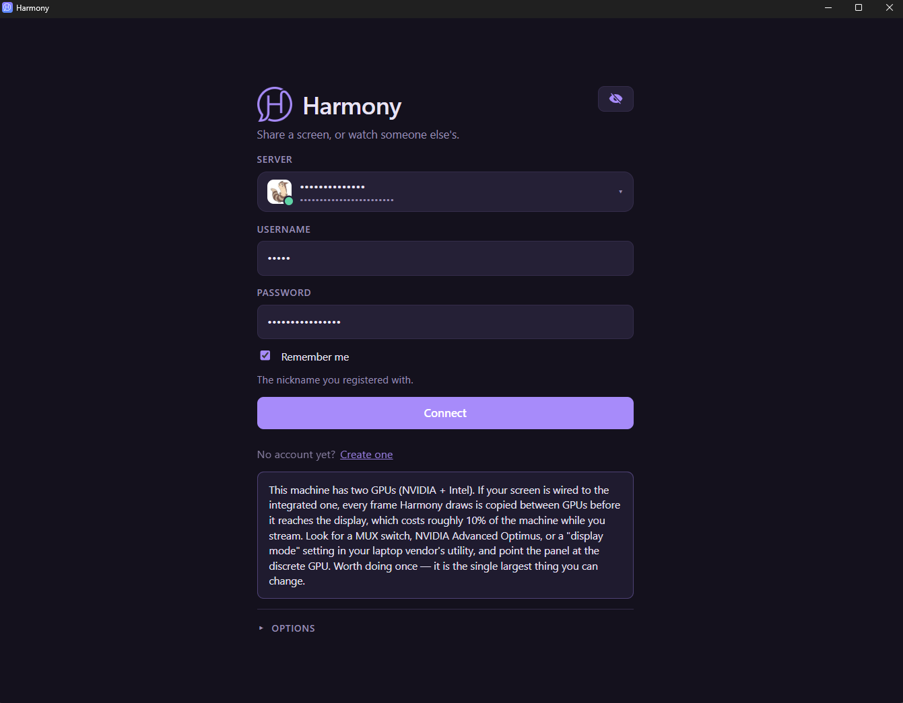
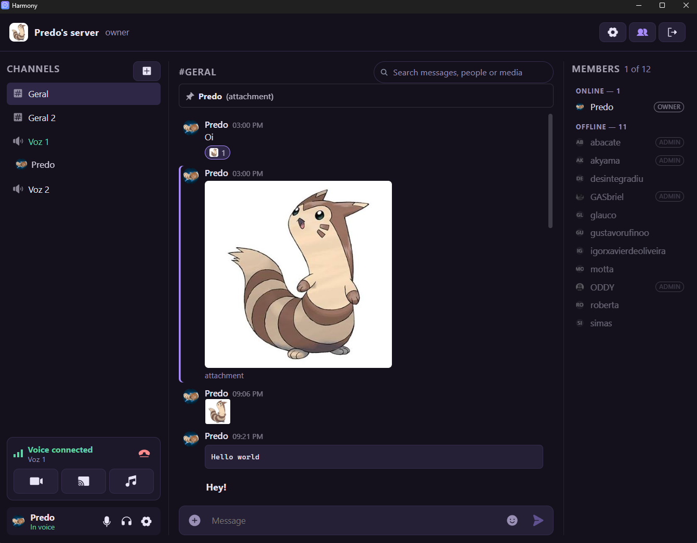
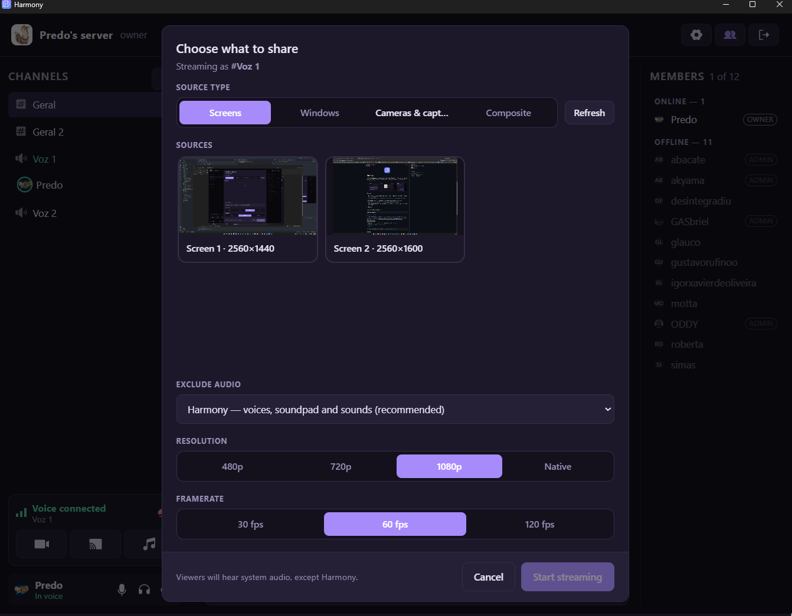

<p align="center">
  
</p>

# Harmony

**Self-hosted, low-latency screen sharing and voice chat for a group of friends.**
A small Discord you run yourself: voice channels with screen and camera sharing,
text channels, and sub-second latency, because the server only relays video and
never re-encodes it.

<p align="center">
  
  
  
</p>

## Features

- **Screen, window or capture-card sharing** at up to native resolution and
  120 fps, H.264 encoded on your GPU. Per-app audio on Windows, and on
  every OS a screen share can leave one app (Harmony, by default) out of its sound.
- **Voice channels** with cameras and screen shares, per-person volume up to
  350%, mute, deafen and an admin soundpad.
- **Camera backgrounds**: blur, a colour, a gradient, or a picture or GIF
  behind you. Done on your own computer, on the GPU, before a frame is sent;
  the server never sees what was behind you.
- **Profile**: a picture, a banner (a GIF works) shown dimmed behind your name
  in the member list and voice channels, a font for your name from ten that
  ship with the app, and a join sound of up to 10 seconds that plays for the
  room when you arrive.
- **Languages**: English, Português (Brasil) and Español, picked in Settings or
  followed from the system; a new one is a single file (see
  [Translating](#translating)).
- **Hotkeys and push to talk**: global hotkeys for mute, deafen, the camera and
  every soundpad clip, and an optional push to talk (off by default) on any key
  or combination. Push to talk works with a game in front; on macOS that needs
  the Accessibility permission, and without it the key works while Harmony is
  in front.
- **Camera quality**: 360p to 1080p, or the camera's native best, at 24, 30,
  60 fps or native, changeable while the camera is on.
- **Text channels** with Markdown, attachments, reactions, custom emoji,
  mentions, pins and search.
- **Accounts and roles**: owner, admins and members, with optional
  password-locked channels.
- **Runs on almost anything.** The server never decodes a frame, so a
  Raspberry Pi is plenty; upload bandwidth is the only real limit.

## Quick start

**Server** (any 64-bit Linux, x86-64 or arm64):

```bash
sudo server/install.sh
```

To update it later: `sudo server/install.sh --update`.

or with Docker. See [docker/](docker/).

**Client:** download it from
[Releases](https://github.com/PedroLucasMiguel/harmony/releases/latest).
Windows (`-setup.exe`), Linux (`.AppImage`), macOS (`.dmg`) and Android
(`.apk`: voice, streams, camera and chat, everything but sharing the phone's
screen; see [client/android](client/android/README.md)). The app
offers new versions itself and installs them on every desktop OS, asking
first. (On macOS that needs the app to sit in Applications or any folder you
can write to, not run from the disk image.)

The builds are unsigned:
- **Windows:** SmartScreen may ask on the first install. Choose *More info → Run anyway*.
- **macOS:** right-click the app → *Open* the first time. The app is signed with
  the project's own certificate, the same on every release, so the permissions
  you grant (screen recording, camera, microphone) are kept across updates.
  A build signed without it (a fork, a local build) loses them on each update
  and opens the download page instead of installing; see
  `client/scripts/make-mac-signing-cert.sh`.

To build it yourself:

```bash
cd client && npm install && npm run build   # -> dist/Harmony-<version>-setup.exe
```

**Releasing:**
1. Bump `version` in `client/package.json` and commit.
2. Push a matching tag: `git tag v3.1.0 && git push origin v3.1.0`.

GitHub Actions builds all three and publishes the release.

TLS, dynamic IPs, ports and troubleshooting are covered in
**[DEPLOYMENT.md](DEPLOYMENT.md)**.

## Translating

The app speaks English, Português (Brasil) and Español, chosen in
*Settings → Appearance → Language* (or following the system's language). Adding
another takes one file and one line:

1. Copy `client/src/renderer/locales/en.js` to `locales/<code>.js` (`fr.js`,
   `de.js`, `pt-PT.js`...) and translate the **values**. Leave the keys alone,
   and leave anything in `{braces}` exactly as it is: the code fills those in
   by name, and may move them anywhere in the sentence. A value written as
   `{ one: '...', other: '...' }` is a plural, chosen by the number; give it
   the forms your language uses (`zero`, `one`, `two`, `few`, `many`, `other`).
2. Add a line to `locales/index.js`:
   ```js
   { code: 'fr', name: 'Français', load: () => import('./fr.js') },
   ```
   with the language's name in itself, since that is how a person who cannot
   read the current one finds it.
3. `cd client && npm run check:locales` lists what is missing (it shows up in
   English until translated, so a partial translation still works), a key that
   English does not have, and any `{placeholder}` that was renamed or lost.

A new string in the code is `t('area.some_key')` in JavaScript, or
`data-i18n="area.some_key"` (and `data-i18n-title`, `-placeholder`,
`-aria-label`) in `index.html`, with the English added to `en.js`. To find
what is still untranslated on screen, run the app with
`localStorage['harmony.pseudo'] = '1'` set in the developer tools and reload:
every translated string is then wrapped in ⟦ ⟧, so anything without them
was missed.

## Built on

[MediaMTX](https://github.com/bluenviron/mediamtx) ·
[Electron](https://www.electronjs.org/) ·
[loopback-capture](https://www.npmjs.com/package/loopback-capture) ·
[mp4-muxer](https://github.com/Vanilagy/mp4-muxer) ·
[MediaPipe](https://ai.google.dev/edge/mediapipe) (camera background segmentation, Apache-2.0)

## License

MIT, see [LICENSE](LICENSE).

---

## Disclaimer: vibe-coded

> [!WARNING]
> **Every line of this repository (client, server, tests and docs) was written
> by an AI coding assistant**, prompted by a human who did not review it line by
> line. It is a recreational project, built for fun and for a handful of
> friends.
>
> It works and has run for a small group, but it has had **no security review,
> no audit and no abuse controls**, and comes with **no stability guarantees**.
> Use it on a LAN or among people you trust, not for anything that matters when
> it breaks. **No warranty.**
