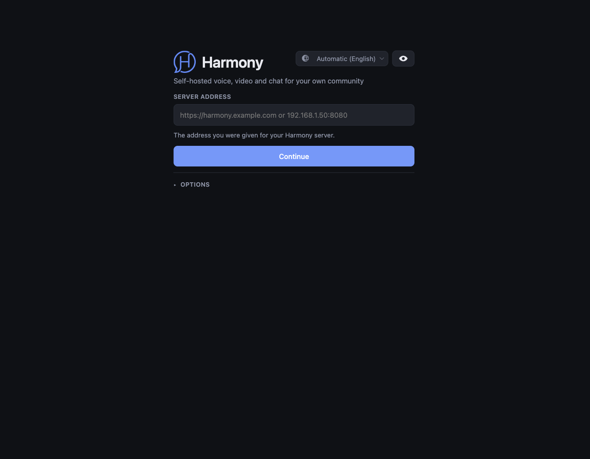
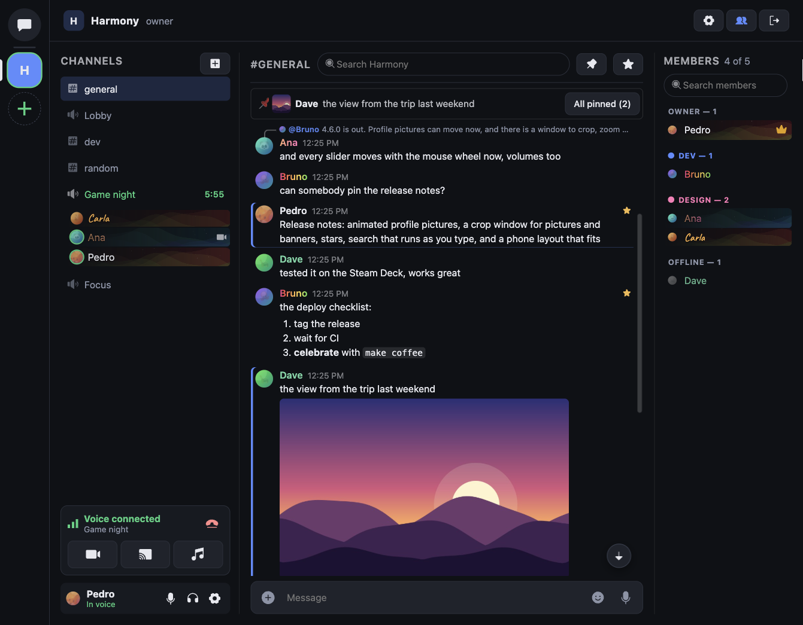
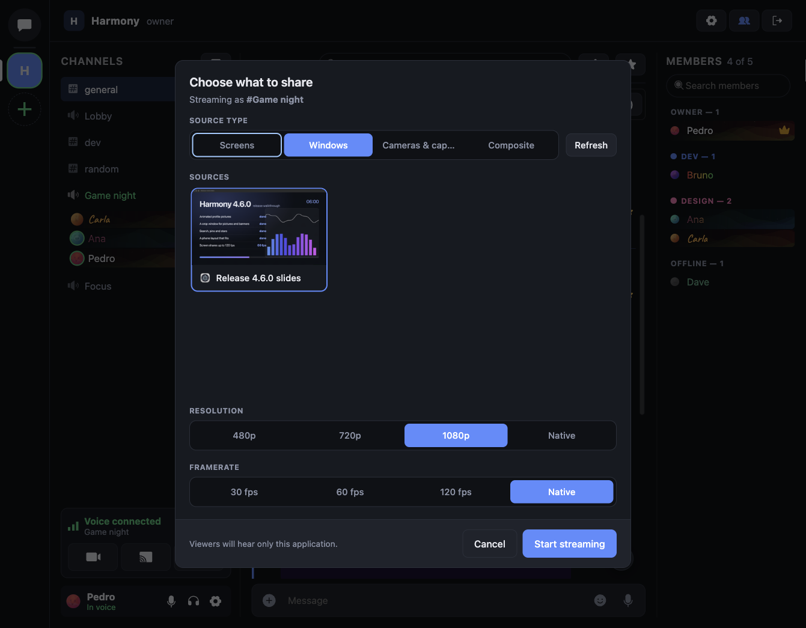
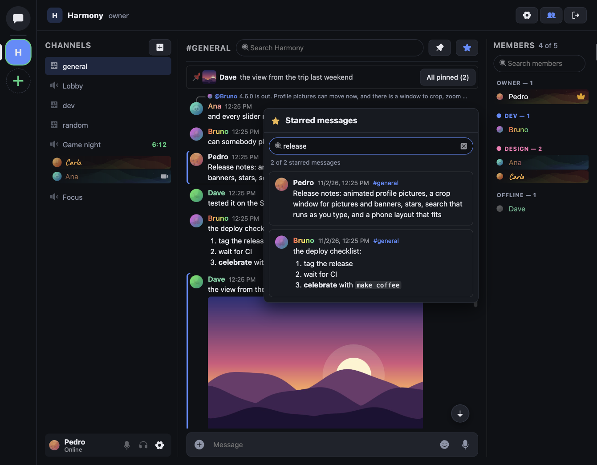
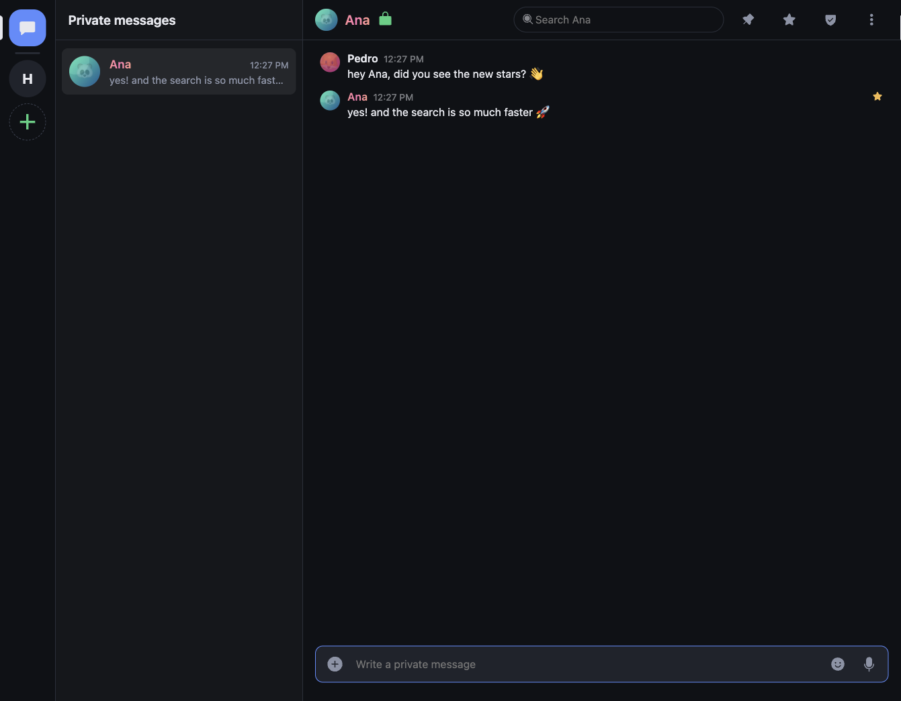
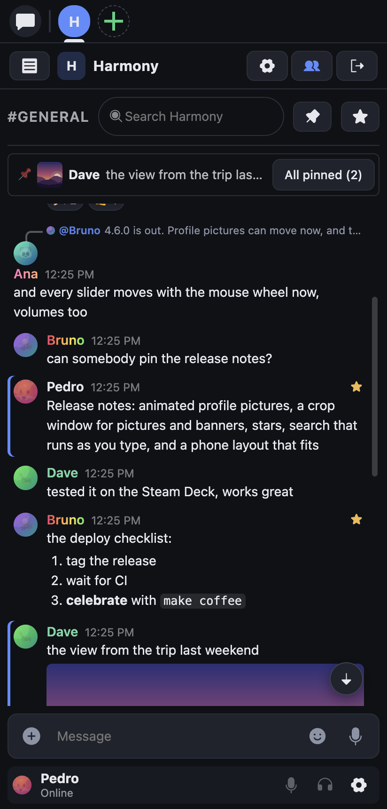

<p align="center">
  
</p>

# Harmony

**Self-hosted, low-latency screen sharing and voice chat for a group of friends.**
A small Discord you run yourself: voice channels with screen and camera sharing,
text channels, and sub-second latency, because the server only relays video and
never re-encodes it.

<p align="center">
  
  
  
</p>
<p align="center">
  
  
  
</p>

A [five-minute tour](media/harmony-demo.mp4) of everything below, recorded from the real app.

## Features

- **Screen, window or capture-card sharing** at up to native resolution and
  120 fps, H.264 encoded on your GPU. Per-app audio on Windows, and on
  every OS a screen share can leave one app (Harmony, by default) out of its sound.
- **Voice channels** with cameras and screen shares, per-person volume up to
  350%, mute, deafen and an admin soundpad.
- **Camera backgrounds**: blur, a colour, a gradient, or a picture or GIF
  behind you. Done on your own computer, on the GPU, before a frame is sent;
  the server never sees what was behind you.
- **Profile**: a picture, a banner (a GIF works) shown dimmed behind your name
  in the member list and voice channels, a font for your name from ten that
  ship with the app, and a join sound of up to 10 seconds that plays for the
  room when you arrive.
- **Server banner**: the owner gives the server a picture or GIF (cut in the same window as a profile banner) that sits
  behind the server's name at the top of the channel list, Discord-style; the strip across the top keeps the buttons.
- **Music Buddy** (off until the owner turns it on): people the owner allows put music on for the voice channel
  or private call they are in, from YouTube links and playlists, Spotify links and playlists (looked up on YouTube),
  or a search; a track can be up to four hours long, for a podcast.
  Everybody in the channel or call hears it in sync, with a volume of their own, and every song is brought to one loudness so
  nobody has to reach for it; the queue can be reordered live, skipped,
  shuffled and repeated. It fetches audio with yt-dlp, which is the owner's call: see
  [DEPLOYMENT.md](DEPLOYMENT.md#music-buddy-optional).
- **A title bar of its own**: a slim bar across the top, drawn in the theme in use, with back and forward through the
  channels and forum posts you have opened (also Command-[ and ] on a Mac, Alt with the arrows elsewhere) and the
  server's name at the middle; the system's window buttons sit over its ends. `HARMONY_NATIVE_FRAME=1` keeps the
  system's own frame instead.
  A button at its end opens About: the version, who made Harmony, the credits and what it is built on.
- **Who reacted**: rest the pointer on a reaction under a message (channel, forum or private) to see who put it
  there, and follow "and N others" (or shift-click, or long-press on a touch screen) for a window listing everybody,
  an emoji at a time. A plain click is still the reaction itself.
- **#channel links**: write `#release-notes` in a message to point at a channel (its name in lower case, spaces as
  dashes); pressed, it opens that text channel or forum. Typing `#` offers the channels to complete, as `@` does for
  people. A `#word` that is no channel you can see stays plain text.
- **Private calls, on a screen of their own**: a call stays on its conversation, over the messages: a tile for each
  person (a ring when they talk, their camera's picture on the stage), the voice channel's own stage for cameras and
  screen shares (the same controls: full screen, volume, a preview of your own), what Music Buddy is playing, and one
  bar of controls -- camera, screen, music, microphone, headphones, hang up. Right-click somebody for how loudly you
  hear them and to mute them for yourself.
- **Profiles from the private messages**: click somebody's picture or name in a conversation (or the heading) to see
  their profile on the server the conversation is on -- banner, badges and roles of that server, with its name on the
  card -- whichever server is open. Read-only, and with no status. The same from a group, on a member's picture or
  name in the conversation or in the dialog that lists the group's people.
- **Status, per server**: online, idle, do not disturb or invisible, from the dot on your picture. It is kept by each
  server separately -- busy on one, free on another -- and shown as a dot on the member list (yellow, red, or none for
  invisible, which looks offline to everybody else). The app left alone for five minutes counts as idle, except on a
  server where you are in a voice channel. Do not disturb silences the sound of mentions on that server only; their
  markers and counts are still there. Private messages show no status and notify as always.
- **Forum channels**: a channel of posts, as in Discord. Each post has a title, words and pictures, videos or files;
  the list shows who wrote it, a first line, its first picture, the reactions it has had, how many have answered and
  when it was last written in, and can be searched and sorted (recent activity, date posted, most answers). Opening a
  post puts its thread beside the list: the post, a line, and the answers, which are ordinary messages (files, voice
  messages, polls, replies, reactions, pins, stars, dropping a file) with a search of the post of their own.
  Posts that mention you (by name, through a role of yours or with @everyone) are lit and counted, and a button keeps
  only those. Admins, and roles given the permissions, can pin posts to the top of the forum (the one pinned last
  first, the rest after it, newest first) and delete any post; everybody can delete their own. A deleted post takes
  every answer, vote and file with it.
- **Polls**: a question with two to twelve options, in a text channel, a private message or a private group,
  from the poll button beside the message box. A poll can have a description, a picture and a footer, take one answer
  or several, hide who voted, and close at a time you pick. Everybody sees the count of each option, the faces of
  who chose it (unless hidden) and a list of who voted for what. In a channel the server counts the votes and keeps
  the voters hidden from everybody when asked. In a private conversation the server cannot read anything: the poll and
  the votes are sealed like messages and every app counts them, so "hide who voted" only hides the names in the app,
  and the end time is kept by each app's clock. An app that does not know polls (a Ciranda client) sees the question
  and the options as words.
- **Private messages**: end-to-end encrypted conversations between two members
  of a server, opened from the button in the top bar or by right-clicking
  someone in the member list. Text, files, replies, edits and reactions are
  sealed on your computer (X25519 and XChaCha20-Poly1305); the server stores and
  forwards ciphertext and never holds a key that opens it. A recovery key brings
  your history to another computer, and a safety number tells you when
  somebody's key has changed. Compatible with [Ciranda](#credits).
- **Private groups**: anybody can make a group of up to 16 people from the
  private messages, and runs it: they add and remove people, rename it, and
  hand it on when they leave. The people they add can only leave. A message to
  a group is sealed once for each person in it, so the server still holds
  nothing it can read (it does see a group's name and who is in it), and somebody
  added later reads from the day they came in, not before.
- **Private calls**: call the person, or the whole group, from a conversation.
  It rings on every server you are signed in to, with the sound on and a card on
  screen; answer or turn it down. A call has the voice channel's microphone,
  camera and screen share, up to 16 people, and leaves a line in the
  conversation ("Call · 12 min", "Missed call"). It goes through the server's
  relay like a voice channel, so unlike the messages it is not end-to-end
  encrypted.
- **Picture in picture** (Settings, Voice & video; off by default): a channel's
  streams in one small window that floats over the app, so you can keep
  chatting while you watch. Step between streams with the arrows; when someone
  with their camera on is talking, their camera takes the window until they
  stop. Drag it by its bar, resize it by its corner. On the desktop app it can
  pop out into a window of its own, always on top, so it keeps playing while
  Harmony is minimised, and does so by itself when Harmony goes out of sight.
- **Password recovery** (Settings, Security): write three questions and answers
  while signed in; if you ever forget the password, answer all three from the
  sign-in screen to choose a new one. Answers ignore capitals, accents,
  punctuation and extra spaces, are stored scrambled like a password, and
  guessing is rate-limited. An account with no questions cannot be recovered,
  and the screen says so. The same tab changes your password.
- **Languages**: English, Português (Brasil) and Español, picked in Settings or
  followed from the system; a new one is a single file (see
  [Translating](#translating)).
- **Hotkeys and push to talk**: global hotkeys for mute, deafen, the camera and
  every soundpad clip, and an optional push to talk (off by default) on any key
  or combination. Push to talk works with a game in front; on macOS that needs
  the Accessibility permission, and without it the key works while Harmony is
  in front.
- **Camera quality**: 360p to 1080p, or the camera's native best, at 24, 30,
  60 fps or native, changeable while the camera is on.
- **Text channels** with Markdown, attachments, reactions, custom emoji,
  mentions (people, `@everyone`, or a role by its name, which notifies everyone
  holding it), pins and search. Press Up in an empty box to edit your last
  message in place.
- **Accounts and roles**: the owner, "super admins" (an admin account with no
  role, made by the owner alone) and any number of roles you define under
  Server settings, each with a name, a colour and permissions: create, edit,
  delete and set passwords on channels; server-mute, kick and ban; delete any
  message; hand out other roles and manage the hierarchy; or "administrator"
  for all of them. Roles rank by their order in the list, and nobody can act on
  someone who ranks as high as they do, change the roles at or above their own,
  or hand out a permission they lack. Names are drawn in the colour of their
  highest role, in the member list (grouped by rank), chat and voice channels.
  A channel or group can be restricted to roles, and is then invisible to
  everybody else; a channel inside a group always follows the group's password
  and roles. Role changes take effect the instant they are made.
- **Runs on almost anything.** The server never decodes a frame, so a
  Raspberry Pi is plenty; upload bandwidth is the only real limit.

## Quick start

**Server** (any 64-bit Linux, x86-64 or arm64):

```bash
sudo server/install.sh
```

To update it later: `sudo server/install.sh --update`.

or with Docker. See [docker/](docker/).

**Client:** download it from
[Releases](https://github.com/PedroLucasMiguel/harmony/releases/latest).
Windows (`-setup.exe`), Linux (`.AppImage`), macOS (`.dmg`) and Android
(`.apk`: voice, streams, camera and chat, everything but sharing the phone's
screen; see [client/android](client/android/README.md)). The app
offers new versions itself and installs them on every desktop OS, asking
first. (On macOS that needs the app to sit in Applications or any folder you
can write to, not run from the disk image.)

The builds are unsigned:
- **Windows:** SmartScreen may ask on the first install. Choose *More info → Run anyway*.
- **macOS:** right-click the app → *Open* the first time. The app is signed with
  the project's own certificate, the same on every release, so the permissions
  you grant (screen recording, camera, microphone) are kept across updates.
  A build signed without it (a fork, a local build) loses them on each update
  and opens the download page instead of installing; see
  `client/scripts/make-mac-signing-cert.sh`.

To build it yourself:

```bash
cd client && npm install && npm run build   # -> dist/Harmony-<version>-setup.exe
```

**Releasing:**
1. Bump `version` in `client/package.json` and commit.
2. Push a matching tag: `git tag v3.1.0 && git push origin v3.1.0`.

GitHub Actions builds all three and publishes the release.

TLS, dynamic IPs, ports and troubleshooting are covered in
**[DEPLOYMENT.md](DEPLOYMENT.md)**.

## Translating

The app speaks English, Português (Brasil) and Español, chosen in
*Settings → Appearance → Language* (or following the system's language). Adding
another takes one file and one line:

1. Copy `client/src/renderer/locales/en.js` to `locales/<code>.js` (`fr.js`,
   `de.js`, `pt-PT.js`...) and translate the **values**. Leave the keys alone,
   and leave anything in `{braces}` exactly as it is: the code fills those in
   by name, and may move them anywhere in the sentence. A value written as
   `{ one: '...', other: '...' }` is a plural, chosen by the number; give it
   the forms your language uses (`zero`, `one`, `two`, `few`, `many`, `other`).
2. Add a line to `locales/index.js`:
   ```js
   { code: 'fr', name: 'Français', load: () => import('./fr.js') },
   ```
   with the language's name in itself, since that is how a person who cannot
   read the current one finds it.
3. `cd client && npm run check:locales` lists what is missing (it shows up in
   English until translated, so a partial translation still works), a key that
   English does not have, and any `{placeholder}` that was renamed or lost.

A new string in the code is `t('area.some_key')` in JavaScript, or
`data-i18n="area.some_key"` (and `data-i18n-title`, `-placeholder`,
`-aria-label`) in `index.html`, with the English added to `en.js`. To find
what is still untranslated on screen, run the app with
`localStorage['harmony.pseudo'] = '1'` set in the developer tools and reload:
every translated string is then wrapped in ⟦ ⟧, so anything without them
was missed.

## Built on

[MediaMTX](https://github.com/bluenviron/mediamtx) ·
[Electron](https://www.electronjs.org/) ·
[loopback-capture](https://www.npmjs.com/package/loopback-capture) ·
[mp4-muxer](https://github.com/Vanilagy/mp4-muxer) ·
[MediaPipe](https://ai.google.dev/edge/mediapipe) (camera background segmentation, Apache-2.0) ·
[noble](https://github.com/paulmillr/noble-curves) (X25519, XChaCha20-Poly1305 and HKDF for private conversations, MIT)

## Credits

**[Ciranda](https://github.com/Brunovncs/ciranda)**, a fork of Harmony by
[Bruno (Brunovncs)](https://github.com/Brunovncs), is where end-to-end encrypted
private conversations were designed and first built. Harmony's version follows
Ciranda's design, trust model and wire protocol (the routes, the message
format, the key derivation and the recovery key), so a client of one can talk
to a client of the other on the same server. Thank you for the work, and for
the known-answer tests that make that checkable.

## License

MIT, see [LICENSE](LICENSE).

---

## Disclaimer: vibe-coded

> [!WARNING]
> **Every line of this repository (client, server, tests and docs) was written
> by an AI coding assistant**, prompted by a human who did not review it line by
> line. It is a recreational project, built for fun and for a handful of
> friends.
>
> It works and has run for a small group, but it has had **no security review,
> no audit and no abuse controls**, and comes with **no stability guarantees**.
> Use it on a LAN or among people you trust, not for anything that matters when
> it breaks. **No warranty.**
